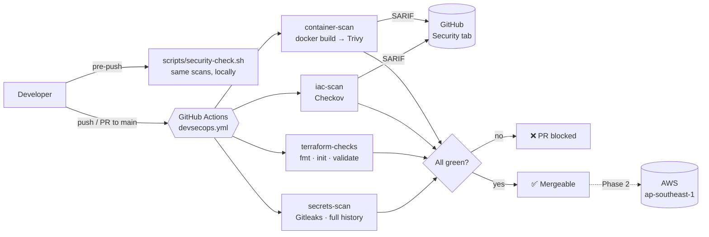

# devsecops-pipeline

[](https://github.com/BabaevvAnnageldi/devsecops-pipeline/actions/workflows/devsecops.yml)

A DevSecOps CI/CD pipeline on GitHub Actions that **blocks insecure code before it reaches AWS**. Every push and pull request to `main` must pass four security gates. If any gate fails, the build goes red and the change can't merge.

> **Phase 1 (this repo):** security gates only. No AWS credentials, no deployments.
> **Phase 2 (planned):** deploy to AWS via GitHub OIDC, only after every gate passes.

---

## Problem

Most cloud breaches don't come from zero-days. They come from ordinary mistakes that reach production:

- An AWS key committed to git "just for a minute"
- An S3 bucket made public, or a security group open to `0.0.0.0/0` on SSH
- A container shipped with a known, already-patched critical CVE

Finding these in production is expensive and sometimes too late. This pipeline **shifts security left**: it catches them on the pull request, in seconds, before `terraform apply` or `docker push` ever runs.

## Architecture



All four jobs run **in parallel**, so the whole pipeline takes about as long as its slowest job.

## What each scanner catches

| Job | Tool | Catches | Fails the build when |
|---|---|---|---|
| `secrets-scan` | [Gitleaks](https://github.com/gitleaks/gitleaks) | API keys, AWS access keys, tokens, private keys, passwords. Scans **every commit**, so a secret "deleted" later is still caught. | Any secret is found |
| `terraform-checks` | Terraform CLI | Unformatted code (`fmt -check`), syntax and type errors (`validate`). Checks *correctness*, not security. | Formatting differs or config is invalid |
| `iac-scan` | [Checkov](https://www.checkov.io/) | Misconfigurations: public S3 buckets, missing encryption, open security groups, missing logging or versioning, over-broad IAM | Any check fails that isn't explicitly skipped |
| `container-scan` | [Trivy](https://trivy.dev/) | Known CVEs in OS packages (Debian) and Python dependencies inside the built image | A **HIGH/CRITICAL** CVE with a fix available exists (`--ignore-unfixed`) |

### Why `--ignore-unfixed`?
A gate should only block on things the developer can act on. A CVE with no released fix can't be patched by bumping a version, so failing the build would just train people to ignore the pipeline. Unfixed issues still appear in the Security tab when they become fixable.

## Repository layout

```
.github/workflows/devsecops.yml   The pipeline: 4 parallel jobs, SHA-pinned actions
terraform/                        Secure AWS setup (passes Checkov)
  versions.tf                     Terraform + AWS provider version pins, default tags
  variables.tf                    Inputs (region defaults to ap-southeast-1) with validation
  kms.tf                          Customer-managed KMS key: rotation on, explicit key policy
  s3_data.tf                      Data bucket: BPA, versioning, SSE-KMS, lifecycle, logging, TLS-only
  s3_logs.tf                      Access-log bucket (SSE-S3; see "Checkov skips")
  outputs.tf                      Bucket names, KMS key ARN/alias
  .terraform.lock.hcl             Provider checksums: CI downloads exactly what was tested
app/                              Flask "hello" app
  Dockerfile                      Slim base pinned by digest, non-root, HEALTHCHECK, gunicorn
  requirements.txt                Every dependency (incl. transitive) pinned to an exact version
demo/insecure.tf.example          Deliberately insecure Terraform to prove the gate works
scripts/security-check.sh         Run all gates locally before pushing
.checkov.yaml                     Shared Checkov config for local and CI
```

### What the secure Terraform does

| Control | Resource | Why |
|---|---|---|
| Block Public Access (all 4 flags) | `aws_s3_bucket_public_access_block` | Main defence against accidental public exposure |
| ACLs disabled | `aws_s3_bucket_ownership_controls` (`BucketOwnerEnforced`) | Removes a whole class of legacy misconfigurations |
| Versioning | `aws_s3_bucket_versioning` | Recover overwritten or deleted objects (ransomware, mistakes) |
| SSE-KMS with a customer-managed key | `aws_kms_key` + SSE config | You control the key policy, can audit use in CloudTrail, and can disable the key |
| Key rotation | `enable_key_rotation = true` | Yearly automatic rotation of key material |
| Lifecycle rules | `aws_s3_bucket_lifecycle_configuration` | Expire old versions and **abort incomplete multipart uploads** (hidden storage cost) |
| Access logging | `aws_s3_bucket_logging` → separate log bucket | Audit trail of who accessed what |
| TLS-only | Bucket policy denying `aws:SecureTransport = false` | No plaintext HTTP access |

### Checkov skips (and why)

Every skip is inline, next to the resource, with a reason, so it shows up in code review:

| Check | Resource | Reason |
|---|---|---|
| `CKV_AWS_144` cross-region replication | both buckets | Needs a second region and doubles cost; not required for this single-region project |
| `CKV2_AWS_62` event notifications | both buckets | An integration feature, not a security control; nothing consumes the events |
| `CKV_AWS_18` access logging | log bucket | It *is* the log target. Logging it to itself would loop |
| `CKV_AWS_145` KMS encryption | log bucket | **S3 server access logging does not support SSE-KMS target buckets.** SSE-S3 (AES256) is the only option AWS supports here |

Result: **57 passed, 0 failed, 6 skipped.**

## Supply-chain security: why every action is pinned to a SHA

```yaml
uses: aquasecurity/trivy-action@ed142fd0673e97e23eac54620cfb913e5ce36c25 # v0.36.0
```

A git **tag** like `@v0.34.0` is a movable pointer: whoever controls the repo can point it at different code at any time. A **commit SHA** is a cryptographic hash of the code itself and can't be changed.

**This isn't hypothetical.** In March 2026 ([CVE-2026-33634](https://github.com/advisories/GHSA-69fq-xp46-6x23), critical), an attacker with stolen credentials:

- force-pushed **76 of 77** `aquasecurity/trivy-action` tags (0.0.1 – 0.34.2) to credential-stealing code,
- replaced **all** `aquasecurity/setup-trivy` tags,
- published a malicious **Trivy v0.69.4** binary (and, days later, malicious v0.69.5/v0.69.6 Docker Hub images).

Every pipeline using `uses: aquasecurity/trivy-action@0.x` silently started running the attacker's code, with access to that pipeline's secrets. Pipelines pinned to a SHA kept running the original, safe code.

Ironically, the *security scanner* was the attack vector. That's why this repo treats CI tooling as untrusted input:

1. **Every** action is pinned to a full 40-char commit SHA, with the version in a comment for humans. SHAs were looked up with `git ls-remote` / `gh api`, never copied from a blog.
2. `trivy-action` is **v0.36.0** (≥ v0.35.0, the first clean release). Its nested `setup-trivy` and `actions/cache` are also SHA-pinned upstream (verified).
3. The Trivy binary is pinned explicitly (`TRIVY_VERSION: v0.75.0`), never 0.69.4. The local script refuses to run if it detects 0.69.4.
4. **Cooldown:** I pin a Trivy release that's a couple of weeks old, not the one published yesterday. Hijacked releases are usually caught within days.
5. Least privilege: top-level `permissions: contents: read`; `security-events: write` only on the two jobs that upload SARIF; `persist-credentials: false` so the token isn't left on disk for later steps.
6. Base image pinned by digest, Python dependencies pinned exactly, Terraform providers locked by checksum.

To update a pin: `git ls-remote https://github.com/<owner>/<action> refs/tags/<tag>` (use the `^{}` line for annotated tags), read the release notes and diff, then bump the SHA *and* the comment. Dependabot can automate this (`package-ecosystem: github-actions`).

**Known residual risk:** `checkov-action` runs `ghcr.io/bridgecrewio/checkov:3.3.29`, pinned by tag inside the action, not by digest. Pinning the action's SHA freezes *which* tag it references, but not the image behind the tag.

## Run it locally

Prerequisites (macOS):

```bash
brew install gitleaks terraform trivy pipx
pipx install checkov        # see "Lessons learned" for why not brew
# Docker Desktop must be running for the container scan
```

Then, from the repo root:

```bash
./scripts/security-check.sh                     # all gates
SKIP_CONTAINER=1 ./scripts/security-check.sh    # skip docker build + Trivy
```

```
==> Summary
  PASS  Secrets scan (gitleaks, full git history)
  PASS  Terraform format (terraform fmt -check)
  PASS  Terraform validate
  PASS  IaC scan (checkov)
  PASS  Container scan (trivy, HIGH/CRITICAL, fixable only)

All security checks passed. Safe to push.
```

## Proof: the gate blocks insecure code

`demo/insecure.tf.example` contains a public S3 bucket (BPA off, `public-read` ACL, `Principal: "*"` policy), no encryption, and a security group with SSH open to `0.0.0.0/0`. The `.example` extension keeps it out of scans on `main`.

PR **`demo/insecure-change`** copies it into `terraform/` and is deliberately left open. Checkov reports **18 failed checks**, including:

```
CKV_AWS_24   Ensure no security groups allow ingress from 0.0.0.0:0 to port 22   FAILED
CKV_AWS_53   Ensure S3 bucket has block public ACLS enabled                       FAILED
CKV_AWS_70   Ensure S3 bucket does not allow an action with any Principal         FAILED
CKV_AWS_20   S3 Bucket has an ACL defined which allows public READ access         FAILED
CKV_AWS_145  Ensure that S3 buckets are encrypted with KMS by default             FAILED
```

Note that `terraform validate` **passes** on that file. Validate checks syntax, not security, which is why both gates exist.

## Screenshots

| | |
|---|---|
| ✅ Green run on `main` |  |
| ❌ Red run on the insecure PR |  |
| 🛡️ Findings in the Security tab |  |

*(Placeholders: add screenshots to `docs/screenshots/`.)*

## Lessons learned

- **A passing scanner isn't proof it scanned everything.** The Homebrew build of Checkov was missing its graph-check definitions. It reported "0 failed" while silently skipping every check that links resources together (versioning, encryption and logging on split `aws_s3_bucket_*` resources). The clue was **0 skipped** even though I had written inline skips. Installing from PyPI fixed it (38 → 57 checks). Now I always sanity-check a scanner against a known-bad input.
- **The security toolchain is part of the attack surface.** CVE-2026-33634 compromised a vulnerability scanner's own GitHub Action. SHA pinning, explicit versions and least-privilege tokens are what limit the damage.
- **Real AWS constraints beat checklist compliance.** Checkov wants every bucket on KMS, but S3 access logs can't be delivered to an SSE-KMS bucket. The right answer is a documented, reviewable skip, not a config that passes the scanner and then fails at runtime.
- **Read the tool's actual behaviour, not just its docs.** With multiple output formats, Checkov's `--output-file-path` is a *file* path; pointed at a directory, it silently wrote nothing. Testing the exact CI flags locally caught this before it became a mysteriously empty Security tab.
- **Gates must be actionable.** `--ignore-unfixed` and inline skips with reasons keep the pipeline strict without becoming noise people learn to bypass.

## Resume bullets

- Built a DevSecOps CI/CD pipeline in GitHub Actions that gates every pull request with secret scanning (Gitleaks), IaC scanning (Checkov) and container vulnerability scanning (Trivy), blocking merges on hardcoded secrets, AWS misconfigurations and fixable HIGH/CRITICAL CVEs, with results published as SARIF to GitHub code scanning.
- Hardened the pipeline against supply-chain attacks after the March 2026 trivy-action compromise (CVE-2026-33634): pinned every third-party action to a verified commit SHA, enforced least-privilege `GITHUB_TOKEN` permissions per job, pinned container base images by digest, and locked Terraform provider checksums.
- Wrote secure-by-default Terraform for AWS (S3 with Block Public Access, versioning, SSE-KMS with a rotating customer-managed key, lifecycle policies, access logging, TLS-only policies) passing 57 Checkov checks with zero failures, and demonstrated the gate catching 18 misconfigurations in a deliberately insecure change.
